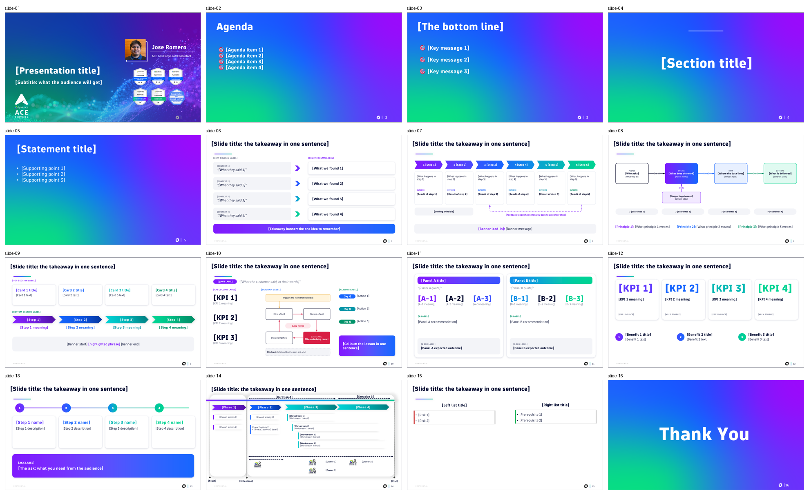
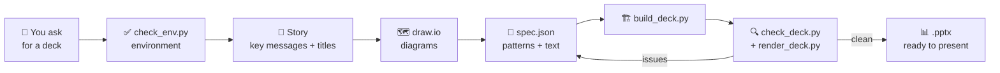
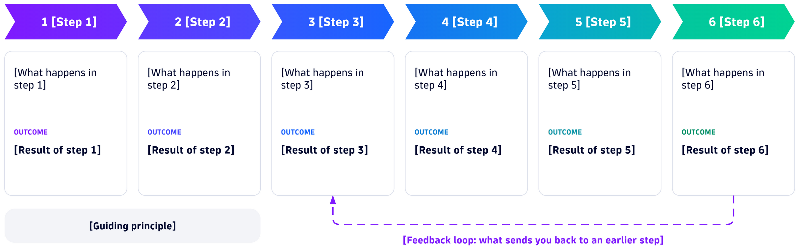
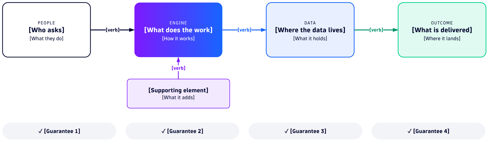
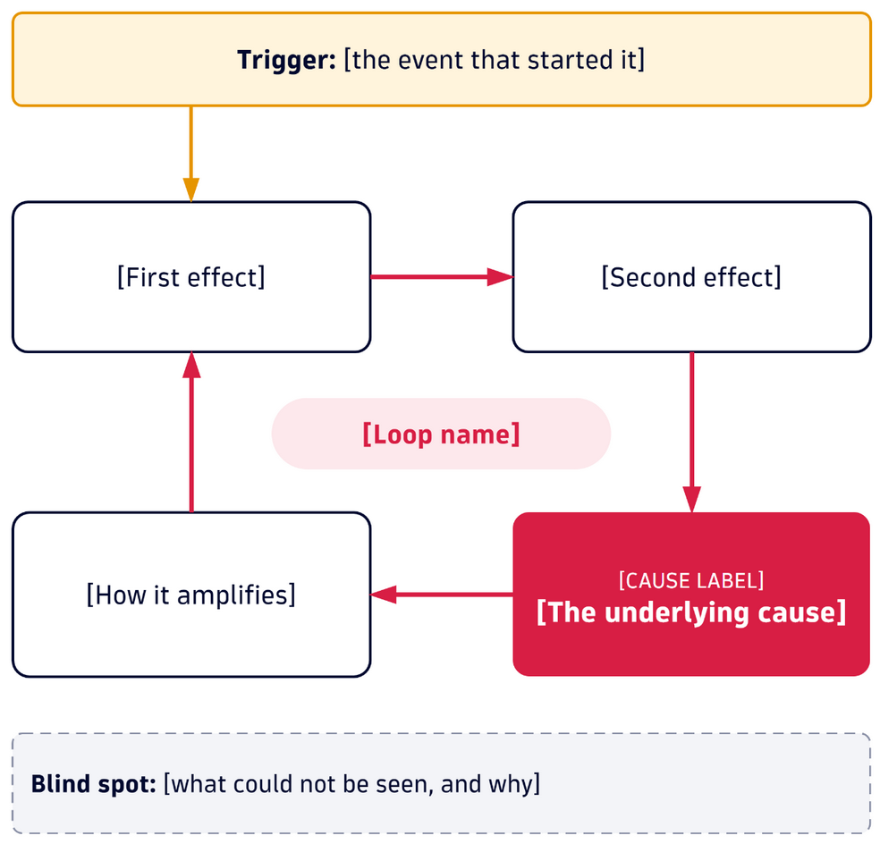
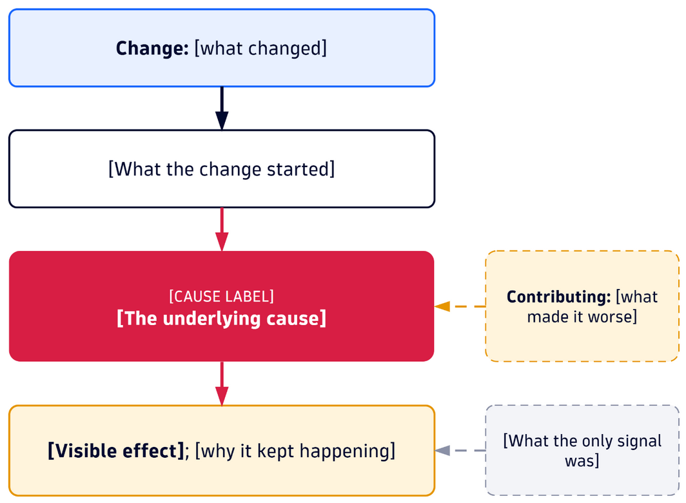
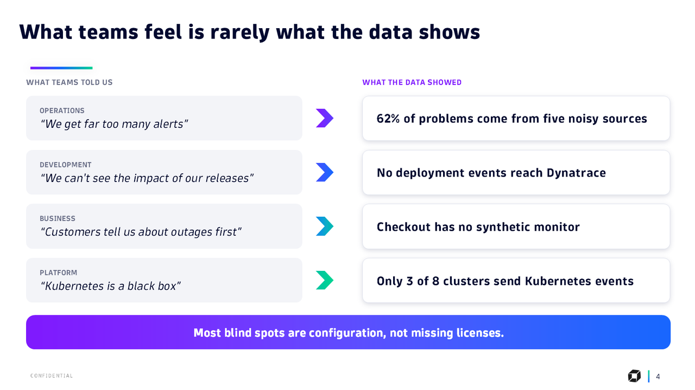
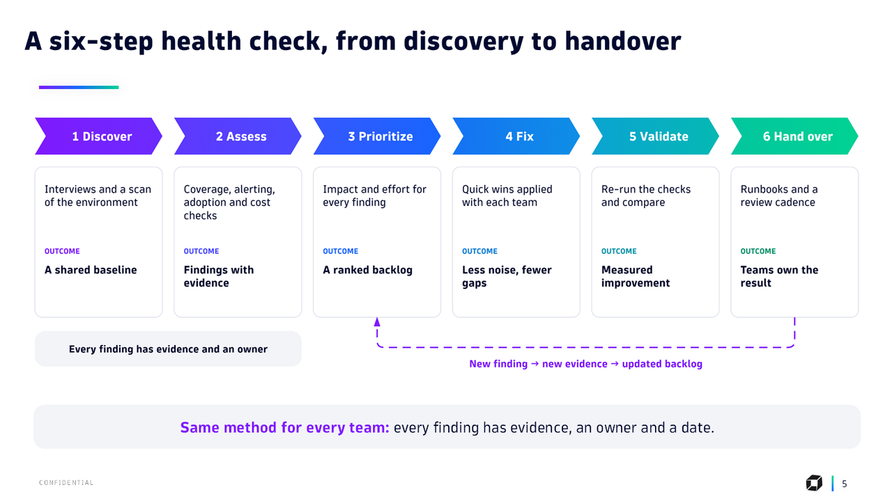
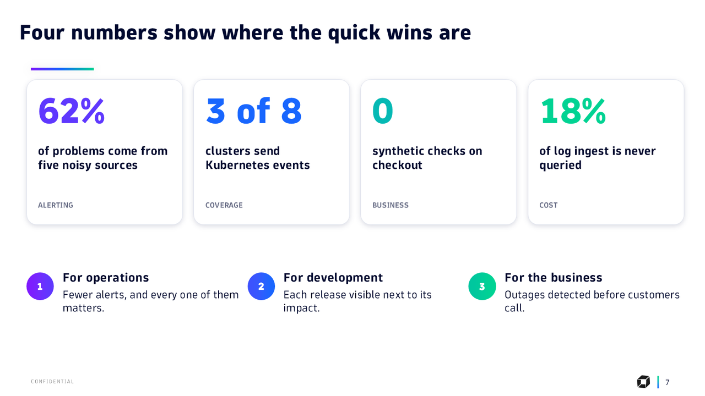
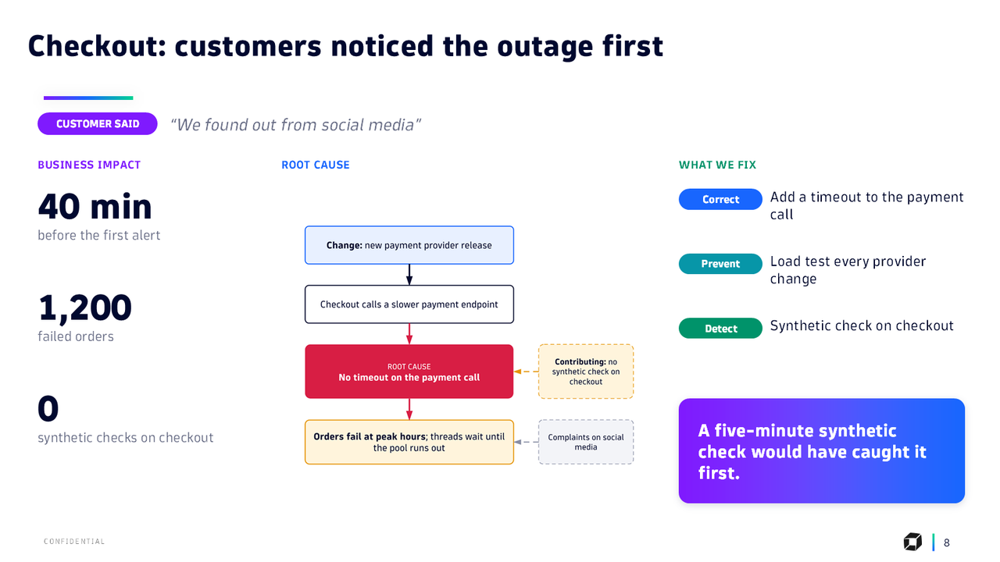

<div align="center">

# Dynatrace Services Deck Skill

**Ask your AI agent for a presentation. Get a Dynatrace Services deck: on brand, on message and ready to present.**

[](https://agentskills.io)
[](#the-16-patterns)
[](#diagrams)
[](https://www.python.org)
[](#use)
[](skills/dt-custom-pptx-services-format-jromero/SKILL.md)

[In short](#in-short) · [The 16 patterns](#the-16-patterns) · [How it works](#how-it-works) · [Install](#install) · [Use](#use) · [Example](#example)


<sub>A 12-slide services deck built by the skill from one spec file (fictional content).</sub>

</div>

---

## In short

`dt-custom-pptx-services-format-jromero` is an open [Agent Skill](https://agentskills.io) that gives any AI agent the **Dynatrace Services presentation format**:

- 🎨 **A definitive template with 16 slide patterns.** It is built from the corporate Dynatrace template and a polished executive deck, so the brand gradients, DT Flow typography, cards, chevrons, KPIs and banners are already designed.
- ✍️ **The agent writes the message, not the layout.** It plans the story (key messages first, one takeaway title per slide), picks a pattern for each slide and fills a JSON spec.
- 🏗️ **One command builds the deck.** `build_deck.py` copies the patterns, swaps the `[placeholders]` while keeping every font, color and position, fits the diagrams and adds speaker notes.
- 🗺️ **Diagrams in the same style.** A draw.io kit with journey, flow and causal diagrams in the Dynatrace palette.
- ✅ **Quality control built in.** It flags leftover placeholders, example diagrams, missing notes, off-brand fonts and text that may not fit, and renders every slide for a visual check.
- 🌐 **English or Spanish**, matching the language of the request.

It works with any agent that reads skills and runs shell commands: Claude Code, GitHub Copilot, OpenAI Codex, Cursor, Kiro, Junie, OpenCode and others.

---

## The 16 patterns



| # | Pattern | Use it for |
|---|---|---|
| 1 | `cover` | Opening slide with title, subtitle and presenter |
| 2 | `agenda` | Agenda on the brand gradient |
| 3 | `key-messages` | The bottom line: three messages to remember |
| 4 | `section` | Section divider |
| 5 | `statement` | A strong idea or context on the gradient |
| 6 | `from-to` | Four rows: what was said → what we found (symptom vs. cause, before vs. after) |
| 7 | `diagram-banner` | Full-width diagram with a framing banner |
| 8 | `diagram-principles` | Diagram plus three principles |
| 9 | `cards-steps` | Four cards (what it covers), four steps (how we act) and a banner |
| 10 | `case` | Customer case: quote, three KPIs, causal diagram, three actions and the lesson |
| 11 | `two-panels` | Two comparable panels with KPIs, recommendation and outcome |
| 12 | `kpis` | Four big numbers and three benefits |
| 13 | `roadmap` | Four next steps and the ask |
| 14 | `phases-plan` | Phased plan (Gantt style) with activities, roles and milestones |
| 15 | `risks-prereqs` | Risks and prerequisites |
| 16 | `closing` | Thank-you slide |

Full catalog with placeholders and text limits (Spanish): [`references/catalogo-patrones.md`](skills/dt-custom-pptx-services-format-jromero/references/catalogo-patrones.md)

---

## How it works



1. **Check the environment.** `check_env.py` verifies python-pptx, the template, the DT Flow fonts, draw.io and a renderer. It installs nothing.
2. **Plan the story.** The agent follows the executive-writing guide. The three key messages come first, every title is a takeaway, and ready-made sequences cover proposals, kickoffs, status reports, closing reports, health checks, executive RCAs and business cases.
3. **Draw the diagrams** from the kit, only for the patterns that need one.
4. **Write the spec.** One entry per slide, with its pattern, text, images and speaker notes.
5. **Build** with `build_deck.py`.
6. **Check** with `check_deck.py` and `render_deck.py`, plus a visual review. Then fix the spec and rebuild.

The design is never touched by hand. **If text doesn't fit, it gets shorter or splits into two slides; the font stays the same size.**

---

## Install

### 1 · Add the skill

```bash
npx skills add JoseRomeroDT/dt-custom-pptx-services-format-jromero
```

Or copy [`skills/dt-custom-pptx-services-format-jromero`](skills/dt-custom-pptx-services-format-jromero) into your agent's skills folder (`~/.claude/skills/`, `~/.agents/skills/`, `.github/skills/`, `.cursor/skills/`…).

### 2 · Prerequisites

| What | Why | How |
|---|---|---|
| Python 3.9+ with **python-pptx** and **Pillow** | Build and check the deck | `pip install python-pptx Pillow` |
| **DT Flow** fonts | The deck renders with the brand font | Dynatrace brand assets |
| **PowerPoint** (Windows) or **LibreOffice + Poppler** | Render slides for the visual check | `brew install --cask libreoffice && brew install poppler` · `apt install libreoffice poppler-utils` |
| **draw.io Desktop** + any draw.io skill | Diagrams | `winget install JGraph.Draw` · `brew install --cask drawio` · `npx skills add jgraph/drawio-mcp --skill drawio` |
| The **pptx** skill | File validation and anything outside the patterns | e.g. Anthropic's `pptx` skill |

### 3 · Check

```bash
python skills/dt-custom-pptx-services-format-jromero/scripts/check_env.py
```

```text
[OK   ] Python 3.9+                  3.14.4
[OK   ] python-pptx                  1.0.2
[OK   ] Pillow                       12.3.0
[OK   ] Template                     …/assets/template-dt-services.pptx
[OK   ] Fuentes DT Flow              DT Flow Bold.otf, DT Flow Extrabold.otf, …
[OK   ] Render para revisión visual  PowerPoint (…\POWERPNT.EXE)
[OK   ] draw.io Desktop (CLI)        31.1.8 -> "C:\Program Files\draw.io\draw.io.exe"
[OK   ] Skill de draw.io             drawio-skill
[OK   ] Skill pptx                   pptx
RESULTADO: LISTO para generar presentaciones.
```

<sub>The scripts report in Spanish: `LISTO` = ready, `FALTA` = missing (blocks), `AVISO` = warning.</sub>

---

## Use

Ask your agent in natural language. The deck comes out in the language you use:

```text
Build a Dynatrace-style deck for the kickoff of the observability project with Acme, 20 minutes
Make a services proposal presentation from these notes: …
Haz una presentación de avance del proyecto en formato Dynatrace
Turn this RCA notebook into a 10-minute executive deck
```

The agent shows you the outline (one title and one pattern per slide) and then delivers:
- the `.pptx`;
- a contact sheet of every slide;
- the list of assumptions for you to confirm.

### The spec

```json
{
  "output": "proposal.pptx",
  "slides": [
    {"pattern": "cover",
     "text": {"[Presentation title]": "Observability health check",
              "[Subtitle: what the audience will get]": "Findings and a 12-week plan"},
     "notes": "What the presenter says."},
    {"pattern": "kpis",
     "text": {"[Slide title: the takeaway in one sentence]": "Four numbers show where the quick wins are",
              "[KPI 1]": "62%", "[KPI 1 meaning]": "of problems come from five noisy sources", "…": "…"},
     "notes": "Where each number comes from."},
    {"pattern": "diagram-banner",
     "images": {"diagram": "diagrams/method.png"},
     "text": {"…": "…"}}
  ]
}
```

- **Keys** are the pattern's `[placeholders]`; the same title key works on every content slide.
- A **list** value creates one paragraph per item, and its box grows. A `""` value removes the paragraph.
- **`images`** fit the diagram into its frame without distortion. Use `{"path", "alt"}` to set the alt text.
- **`remove`** drops optional shapes by name or placeholder.

### Scripts

| Script | What it does |
|---|---|
| `check_env.py` | Checks the environment and tells you how to fix what's missing |
| `build_deck.py spec.json -o deck.pptx` | Builds the deck (`--list-patterns`, `--strict`) |
| `check_deck.py deck.pptx` | Quality checks: placeholders, example diagrams, notes, fonts, title length, text fit |
| `render_deck.py deck.pptx -o render/` | PNG per slide plus `grid.png` (PowerPoint on Windows, LibreOffice elsewhere) |
| `inspect_deck.py deck.pptx` | Shapes, names, positions and text of any `.pptx` |

---

## Diagrams

The kit in [`assets/drawio/`](skills/dt-custom-pptx-services-format-jromero/assets/drawio) uses the deck's style: DT Flow, step gradients, brand colors, and red reserved for causes and failures.

| `journey-6-steps` | `flow-actors` |
|---|---|
|  |  |
| **`causal-loop`** | **`causal-chain`** |
|  |  |

To use one, copy a kit file, change only the labels and export it as a PNG with the editable XML embedded:

```bash
drawio -x -f png -e -s 2 -b 6 -o diagrams/method.png diagrams/method.drawio
```

---

## Example

[`examples/health-check`](examples/health-check) is a complete 12-slide services deck with fictional content. It has one spec, two diagrams and a preview of every slide. To rebuild it:

```bash
python skills/dt-custom-pptx-services-format-jromero/scripts/build_deck.py examples/health-check/spec.json -o health-check.pptx
python skills/dt-custom-pptx-services-format-jromero/scripts/check_deck.py health-check.pptx
# RESULTADO: 12 slides · 0 errores · 0 avisos
```

| | |
|---|---|
|  |  |
|  |  |

---

<details>
<summary><b>Repository layout</b></summary>

```text
dt-custom-pptx-services-format-jromero/
├── skills/
│   └── dt-custom-pptx-services-format-jromero/   the skill (what gets installed)
│       ├── SKILL.md                              agent instructions (Spanish)
│       ├── scripts/                              check_env · build_deck · check_deck · render_deck · inspect_deck
│       ├── references/                           pattern catalog, executive writing, visual style, draw.io
│       └── assets/                               template, previews, draw.io kit, example spec
├── examples/health-check/                        full example: spec, diagrams and previews
├── docs/images/                                  README images
├── AGENTS.md                                     instructions for agents without skill support
└── LICENSE
```

</details>

<details>
<summary><b>Credits and brand assets</b></summary>

- The template is built from the corporate **Dynatrace presentation template** and the executive deck *RCA journey*, with all case content replaced by placeholders.
- **Dynatrace brand assets** (logos, backgrounds, badges, the DT Flow font name) belong to Dynatrace and follow Dynatrace brand guidelines. The DT Flow fonts are **not** included: install them from the official brand assets.
- The cover keeps the author's presenter block (name, photo and certification badges). To use another presenter, replace those texts and pictures in your own copy of the template.

</details>

**Resumen en español:** skill para que cualquier agente de IA arme presentaciones con el formato de Dynatrace Services. Usa un template definitivo de 16 patrones y diagramas draw.io en la paleta de la marca. El agente escribe el mensaje en un spec JSON y `build_deck.py` arma el `.pptx` sin tocar el diseño. Las instrucciones de la skill están en español y la presentación sale en el idioma del pedido.

**Author:** Edunzz (Jose Eduardo Romero Jimenez) · **License:** [MIT](LICENSE) for the scripts and documentation.
