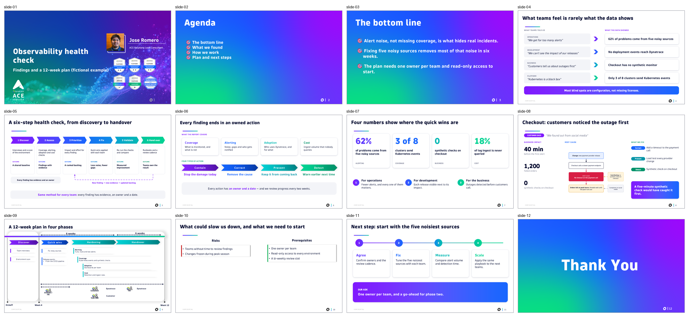

# Example: observability health check (fictional)

A complete 12-slide services deck built with the skill from a single spec. **All names and figures are fictional.**



## What it shows

| Slide | Pattern | What it demonstrates |
|---|---|---|
| 1 | `cover` | Title and subtitle; the presenter block stays as in the template |
| 2 | `agenda` | Four agenda items |
| 3 | `key-messages` | The bottom line: three messages, each with a proof point |
| 4 | `from-to` | What teams said → what the data showed |
| 5 | `diagram-banner` | A custom diagram from `journey-6-steps.drawio` |
| 6 | `cards-steps` | What the report covers and the four types of action |
| 7 | `kpis` | Four numbers with unit and source, and three benefits |
| 8 | `case` | One incident told end to end, with a diagram from `causal-chain.drawio` |
| 9 | `phases-plan` | A 12-week plan in four phases |
| 10 | `risks-prereqs` | A placeholder expanded into a list: `"[Prerequisite 2]": ["…", "…"]` |
| 11 | `roadmap` | Next steps and the ask |
| 12 | `closing` | Thank-you slide |

## Files

| Path | What it is |
|---|---|
| [`spec.json`](spec.json) | The whole deck: patterns, texts, images and speaker notes |
| [`diagrams/`](diagrams/) | The two diagrams (`.drawio` editable + `.png`) |
| [`preview/`](preview/) | Every slide as rendered by PowerPoint, plus `grid.png` |

## Rebuild it

From the repository root:

```bash
python skills/dt-custom-pptx-services-format-jromero/scripts/build_deck.py examples/health-check/spec.json -o health-check.pptx
python skills/dt-custom-pptx-services-format-jromero/scripts/check_deck.py health-check.pptx
python skills/dt-custom-pptx-services-format-jromero/scripts/render_deck.py health-check.pptx -o render/
```
