# Catálogo de patrones del template

El template `assets/template-dt-services.pptx` tiene **16 patrones**: cada slide es un patrón y su id es el nombre del slide. En el spec se elige con `"pattern": "<id>"`; un patrón se puede usar varias veces.

- Las **claves** son los textos `[entre corchetes]` del patrón. Se reemplazan con `"text": {"[clave]": "valor"}`.
- Todas las slides de contenido comparten la clave de título `[Slide title: the takeaway in one sentence]`.
- Un valor lista (`["a", "b"]`) crea un párrafo por elemento; un valor `""` borra el párrafo.
- Las imágenes llamadas `diagram` se reemplazan con `"images": {"diagram": "ruta.png"}`: se ajustan al marco sin deformarse.
- Las formas se quitan con `"remove": ["nombre de forma" | "[clave]"]`. Los nombres se ven con `python scripts/inspect_deck.py assets/template-dt-services.pptx --slide N`.
- Los límites de caracteres son orientativos: los confirma el render.

Vista general: `assets/template-preview.png`. Vista de cada patrón: `assets/previews/NN-<id>.png`.

| # | id | Patrón | Cuándo usarlo |
|---|---|---|---|
| 1 | `cover` | Portada | Siempre, como primera slide. |
| 2 | `agenda` | Agenda | Presentaciones de más de 6 slides. |
| 3 | `key-messages` | Mensajes clave (bottom line) | Justo después de la portada o la agenda: lo que el público debe recordar si solo ve una slide. |
| 4 | `section` | Separador de sección | Decks de más de 10 slides, para separar bloques. |
| 5 | `statement` | Idea fuerza sobre degradado | Contexto, una definición o una postura que merece una slide propia. |
| 6 | `from-to` | Lo que se dijo → lo que encontramos | Síntoma vs. causa, antes vs. después, mito vs. realidad, pedido vs. propuesta. |
| 7 | `diagram-banner` | Diagrama a todo el ancho + banner | Un proceso, journey o arquitectura que se explica solo con el diagrama. |
| 8 | `diagram-principles` | Diagrama + 3 principios | Cómo funciona algo y las 3 garantías o principios que lo sostienen. |
| 9 | `cards-steps` | 4 tarjetas + 4 pasos + banner | Un marco de trabajo: qué incluye (arriba) y cómo se actúa (abajo). |
| 10 | `case` | Caso de cliente | Un caso real contado de punta a punta: cita, impacto, causa y qué se corrige. |
| 11 | `two-panels` | Dos paneles comparables | Dos frentes, dos opciones o dos hallazgos con la misma estructura. |
| 12 | `kpis` | 4 cifras + 3 beneficios | Por qué importa: cifras de impacto y a quién beneficia. |
| 13 | `roadmap` | Próximos pasos + pedido | Cierre de propuestas, kickoffs y reportes: qué sigue y qué se necesita del público. |
| 14 | `phases-plan` | Plan por fases (Gantt) | Propuestas de servicio y kickoffs: fases, actividades, frentes, roles y hitos. |
| 15 | `risks-prereqs` | Riesgos y prerrequisitos | Propuestas y kickoffs: qué puede frenar el proyecto y qué se necesita para empezar. |
| 16 | `closing` | Cierre | Siempre, como última slide. |

## 1. `cover` — Portada

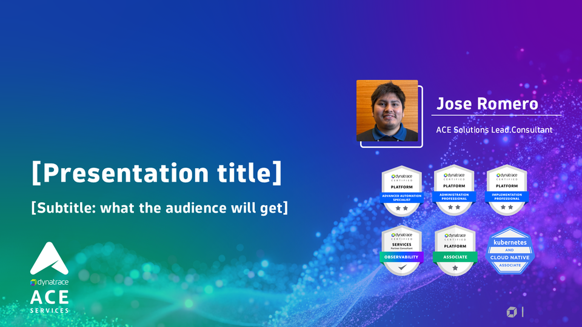

- **Cuándo usarlo:** Siempre, como primera slide.
- **Límites:** Título ≤ 40 caracteres (cabe en 2 líneas). Subtítulo ≤ 60.
- **Consejos:** El presentador (nombre, rol, foto e insignias) es fijo. Para otro presentador, cambia `Jose Romero` y `ACE Solutions Lead.Consultant` como claves de texto.

Claves, en orden de lectura:

```text
[Presentation title]
[Subtitle: what the audience will get]
```

## 2. `agenda` — Agenda

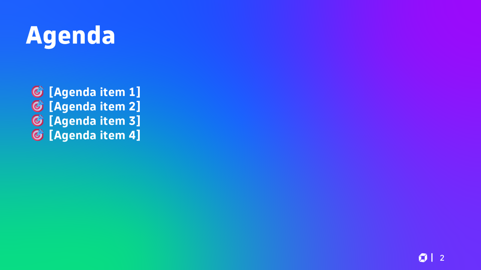

- **Cuándo usarlo:** Presentaciones de más de 6 slides.
- **Límites:** 3 a 6 puntos, ≤ 40 caracteres cada uno.
- **Consejos:** Para más puntos usa una lista: `"[Agenda item 4]": ["Punto 4", "Punto 5"]`. Para menos, `"[Agenda item 4]": ""` borra la línea.

Claves, en orden de lectura:

```text
[Agenda item 1]
[Agenda item 2]
[Agenda item 3]
[Agenda item 4]
```

## 3. `key-messages` — Mensajes clave (bottom line)

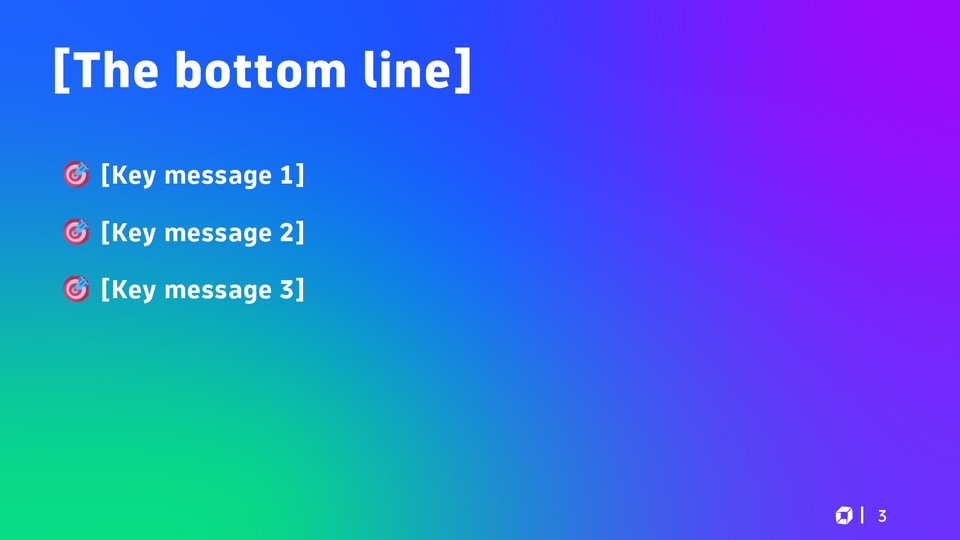

- **Cuándo usarlo:** Justo después de la portada o la agenda: lo que el público debe recordar si solo ve una slide.
- **Límites:** Exactamente 3 mensajes, ≤ 90 caracteres cada uno (2 líneas máx.). Título ≤ 25.
- **Consejos:** Cada mensaje es una afirmación completa con una prueba (cifra, caso), no un tema.

Claves, en orden de lectura:

```text
[The bottom line]
[Key message 1]
[Key message 2]
[Key message 3]
```

## 4. `section` — Separador de sección

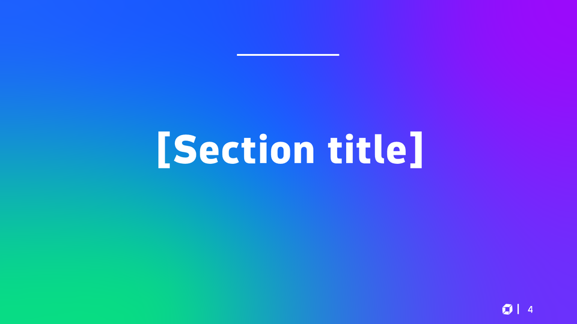

- **Cuándo usarlo:** Decks de más de 10 slides, para separar bloques.
- **Límites:** Título ≤ 30 caracteres.

Claves, en orden de lectura:

```text
[Section title]
```

## 5. `statement` — Idea fuerza sobre degradado

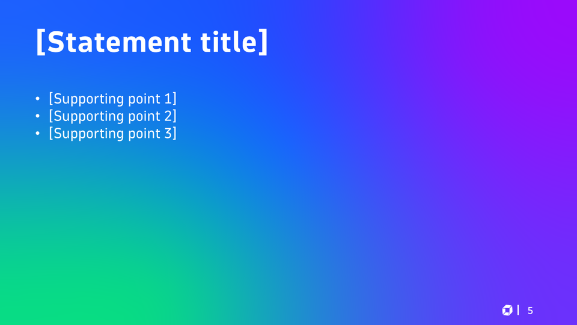

- **Cuándo usarlo:** Contexto, una definición o una postura que merece una slide propia.
- **Límites:** Título ≤ 40. 1 a 4 puntos de ≤ 70 caracteres.
- **Consejos:** Puntos vacíos (`""`) se borran.

Claves, en orden de lectura:

```text
[Statement title]
[Supporting point 1]
[Supporting point 2]
[Supporting point 3]
```

## 6. `from-to` — Lo que se dijo → lo que encontramos

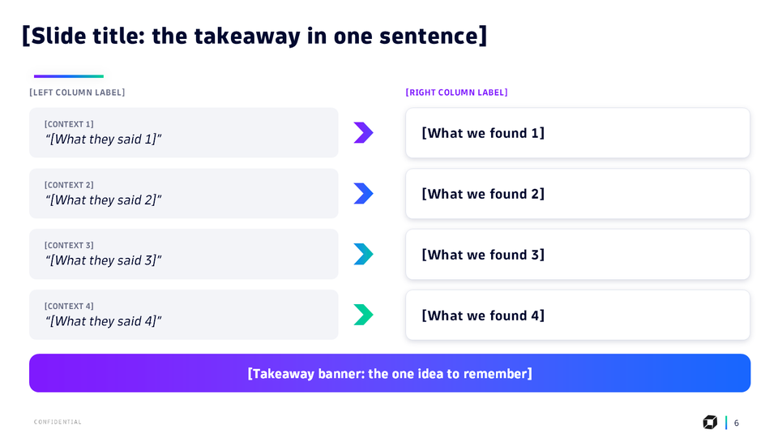

- **Cuándo usarlo:** Síntoma vs. causa, antes vs. después, mito vs. realidad, pedido vs. propuesta.
- **Límites:** 4 filas. Contexto ≤ 15 (MAYÚSCULAS), cita ≤ 50, hallazgo ≤ 60. Banner ≤ 100.
- **Consejos:** Para 3 filas, quita la cuarta: `"remove": ["[CONTEXT 4]", "[What we found 4]", "Chevron 18"]`.

Claves, en orden de lectura:

```text
[Slide title: the takeaway in one sentence]
[LEFT COLUMN LABEL]
[RIGHT COLUMN LABEL]
[CONTEXT 1]
[What they said 1]
[What we found 1]
[CONTEXT 2]
[What they said 2]
[What we found 2]
[CONTEXT 3]
[What they said 3]
[What we found 3]
[CONTEXT 4]
[What they said 4]
[What we found 4]
[Takeaway banner: the one idea to remember]
```

## 7. `diagram-banner` — Diagrama a todo el ancho + banner

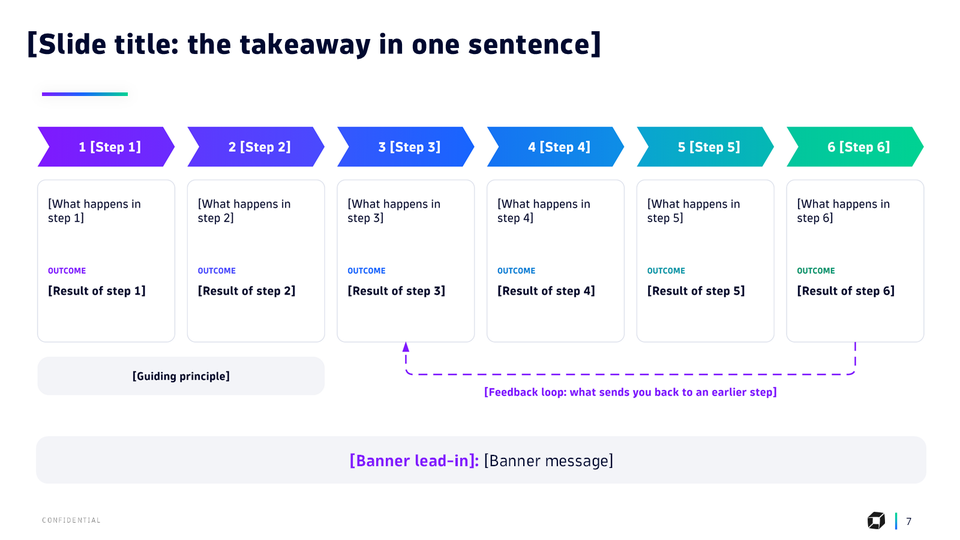

- **Cuándo usarlo:** Un proceso, journey o arquitectura que se explica solo con el diagrama.
- **Límites:** Imagen `diagram` con proporción ≈ 3.2:1 (12.43 × 3.9 in). Banner: entrada ≤ 30 + mensaje ≤ 80.
- **Imágenes:** `diagram` (12.43 × 3.9 in, proporción 3.19:1)
- **Consejos:** Parte de `assets/drawio/journey-6-steps.drawio` o `flow-actors.drawio`.

Claves, en orden de lectura:

```text
[Slide title: the takeaway in one sentence]
[Banner lead-in]
[Banner message]
```

## 8. `diagram-principles` — Diagrama + 3 principios

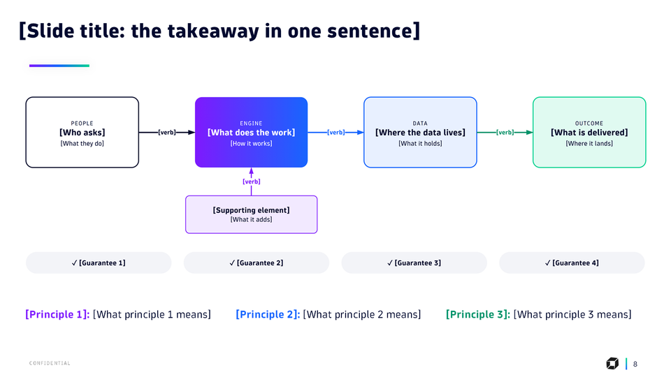

- **Cuándo usarlo:** Cómo funciona algo y las 3 garantías o principios que lo sostienen.
- **Límites:** Imagen `diagram` ≈ 3.4:1 (12.43 × 3.61 in). Principio: etiqueta ≤ 15 + texto ≤ 50.
- **Imágenes:** `diagram` (12.43 × 3.61 in, proporción 3.44:1)
- **Consejos:** Parte de `assets/drawio/flow-actors.drawio`.

Claves, en orden de lectura:

```text
[Slide title: the takeaway in one sentence]
[Principle 1]
[What principle 1 means]
[Principle 2]
[What principle 2 means]
[Principle 3]
[What principle 3 means]
```

## 9. `cards-steps` — 4 tarjetas + 4 pasos + banner

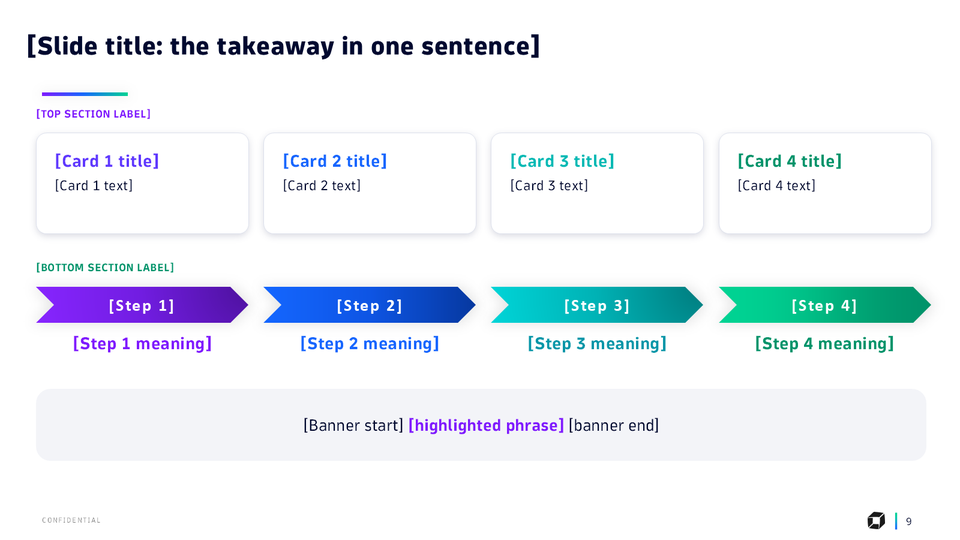

- **Cuándo usarlo:** Un marco de trabajo: qué incluye (arriba) y cómo se actúa (abajo).
- **Límites:** Etiquetas de sección ≤ 45 (MAYÚSCULAS). Tarjeta: título ≤ 20, texto ≤ 50. Paso ≤ 12, significado ≤ 25. Banner ≤ 130 en total.
- **Consejos:** Los 4 pasos tienen colores fijos (violeta → azul → turquesa → verde): úsalos en orden.

Claves, en orden de lectura:

```text
[Slide title: the takeaway in one sentence]
[TOP SECTION LABEL]
[Card 1 title]
[Card 1 text]
[Card 2 title]
[Card 2 text]
[Card 3 title]
[Card 3 text]
[Card 4 title]
[Card 4 text]
[BOTTOM SECTION LABEL]
[Step 1]
[Step 2]
[Step 3]
[Step 4]
[Step 1 meaning]
[Step 2 meaning]
[Step 3 meaning]
[Step 4 meaning]
[Banner start]
[highlighted phrase]
[banner end]
```

## 10. `case` — Caso de cliente

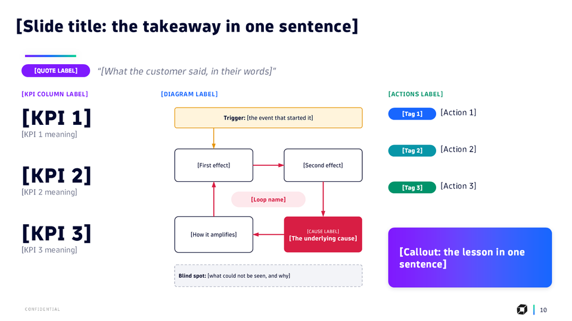

- **Cuándo usarlo:** Un caso real contado de punta a punta: cita, impacto, causa y qué se corrige.
- **Límites:** Cita ≤ 80. KPI ≤ 7 caracteres + significado ≤ 35. Etiqueta ≤ 9. Acción ≤ 45. Lección ≤ 70. Imagen `diagram` ≈ 1:1 (4.48 × 4.3 in).
- **Imágenes:** `diagram` (4.48 × 4.3 in, proporción 1.04:1)
- **Consejos:** Parte de `assets/drawio/causal-loop.drawio` (bucle) o `causal-chain.drawio` (cadena). Las etiquetas de acción suelen ser Contain / Correct / Prevent / Detect.

Claves, en orden de lectura:

```text
[Slide title: the takeaway in one sentence]
[QUOTE LABEL]
[What the customer said, in their words]
[KPI COLUMN LABEL]
[DIAGRAM LABEL]
[ACTIONS LABEL]
[KPI 1]
[KPI 1 meaning]
[Tag 1]
[Action 1]
[Tag 2]
[Action 2]
[KPI 2]
[KPI 2 meaning]
[Tag 3]
[Action 3]
[KPI 3]
[KPI 3 meaning]
[Callout: the lesson in one sentence]
```

## 11. `two-panels` — Dos paneles comparables

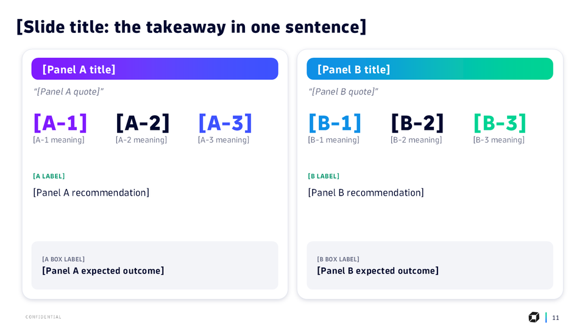

- **Cuándo usarlo:** Dos frentes, dos opciones o dos hallazgos con la misma estructura.
- **Límites:** Título de panel ≤ 30. KPI ≤ 6 caracteres + significado ≤ 25. Recomendación ≤ 100. Resultado ≤ 70.
- **Consejos:** Los dos paneles deben ser paralelos: mismas métricas, mismo orden.

Claves, en orden de lectura:

```text
[Slide title: the takeaway in one sentence]
[Panel A title]
[Panel B title]
[Panel A quote]
[Panel B quote]
[A-1]
[A-1 meaning]
[A-2]
[A-2 meaning]
[A-3]
[A-3 meaning]
[B-1]
[B-1 meaning]
[B-2]
[B-2 meaning]
[B-3]
[B-3 meaning]
[A LABEL]
[B LABEL]
[Panel A recommendation]
[Panel B recommendation]
[A BOX LABEL]
[Panel A expected outcome]
[B BOX LABEL]
[Panel B expected outcome]
```

## 12. `kpis` — 4 cifras + 3 beneficios

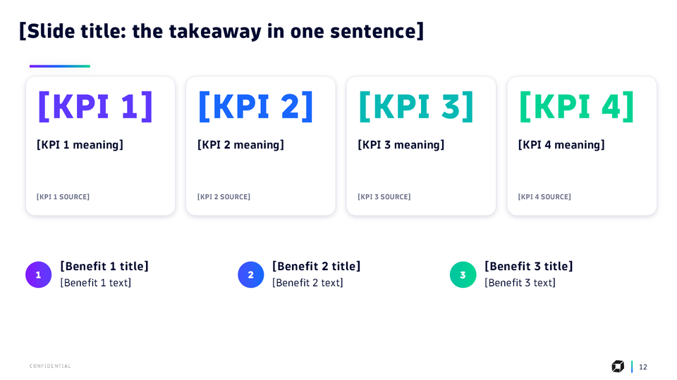

- **Cuándo usarlo:** Por qué importa: cifras de impacto y a quién beneficia.
- **Límites:** KPI ≤ 7 caracteres. Significado ≤ 45. Fuente ≤ 25 (MAYÚSCULAS). Beneficio: título ≤ 25, texto ≤ 55.
- **Consejos:** Cada cifra con su unidad (min, %, ×) y su fuente.

Claves, en orden de lectura:

```text
[Slide title: the takeaway in one sentence]
[KPI 1]
[KPI 2]
[KPI 3]
[KPI 4]
[KPI 1 meaning]
[KPI 2 meaning]
[KPI 3 meaning]
[KPI 4 meaning]
[KPI 1 SOURCE]
[KPI 2 SOURCE]
[KPI 3 SOURCE]
[KPI 4 SOURCE]
[Benefit 1 title]
[Benefit 1 text]
[Benefit 2 title]
[Benefit 2 text]
[Benefit 3 title]
[Benefit 3 text]
```

## 13. `roadmap` — Próximos pasos + pedido

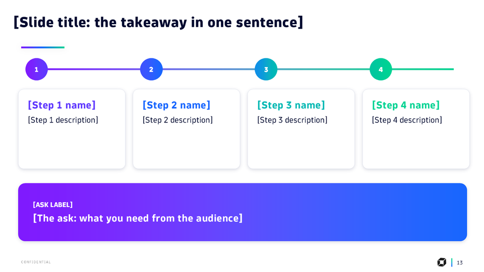

- **Cuándo usarlo:** Cierre de propuestas, kickoffs y reportes: qué sigue y qué se necesita del público.
- **Límites:** 4 pasos: nombre ≤ 15, descripción ≤ 70. Pedido ≤ 90.
- **Consejos:** El pedido es concreto: nombres, accesos, una decisión, una fecha.

Claves, en orden de lectura:

```text
[Slide title: the takeaway in one sentence]
[Step 1 name]
[Step 1 description]
[Step 2 name]
[Step 2 description]
[Step 3 name]
[Step 3 description]
[Step 4 name]
[Step 4 description]
[ASK LABEL]
[The ask: what you need from the audience]
```

## 14. `phases-plan` — Plan por fases (Gantt)

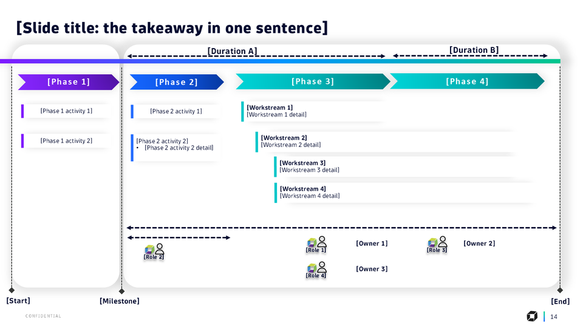

- **Cuándo usarlo:** Propuestas de servicio y kickoffs: fases, actividades, frentes, roles y hitos.
- **Límites:** Fase ≤ 12. Duración ≤ 12. Actividad ≤ 25. Frente: título ≤ 20 + detalle ≤ 40. Rol ≤ 15. Responsable ≤ 12.
- **Consejos:** Slide densa: úsala como respaldo del plan, no como mensaje principal. Las duraciones A y B cubren las dos mitades del plan.

Claves, en orden de lectura:

```text
[Slide title: the takeaway in one sentence]
[Duration A]
[Duration B]
[Phase 1]
[Phase 2]
[Phase 3]
[Phase 4]
[Workstream 1]
[Workstream 1 detail]
[Phase 1 activity 1]
[Phase 2 activity 1]
[Workstream 2]
[Workstream 2 detail]
[Phase 1 activity 2]
[Phase 2 activity 2]
[Phase 2 activity 2 detail]
[Workstream 3]
[Workstream 3 detail]
[Role 1]
[Role 2]
[Role 3]
[Role 4]
[Workstream 4]
[Workstream 4 detail]
[Owner 1]
[Owner 2]
[Owner 3]
[Start]
[Milestone]
[End]
```

## 15. `risks-prereqs` — Riesgos y prerrequisitos

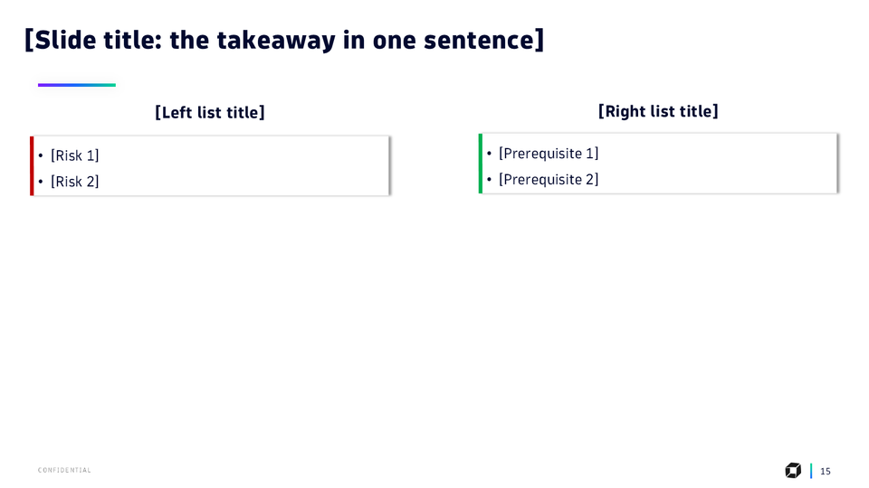

- **Cuándo usarlo:** Propuestas y kickoffs: qué puede frenar el proyecto y qué se necesita para empezar.
- **Límites:** Títulos de lista ≤ 25. 2 a 5 elementos por lista, ≤ 50 caracteres.
- **Consejos:** Expande con listas: `"[Prerequisite 2]": ["…", "…"]`; la caja crece sola.

Claves, en orden de lectura:

```text
[Slide title: the takeaway in one sentence]
[Right list title]
[Left list title]
[Risk 1]
[Risk 2]
[Prerequisite 1]
[Prerequisite 2]
```

## 16. `closing` — Cierre

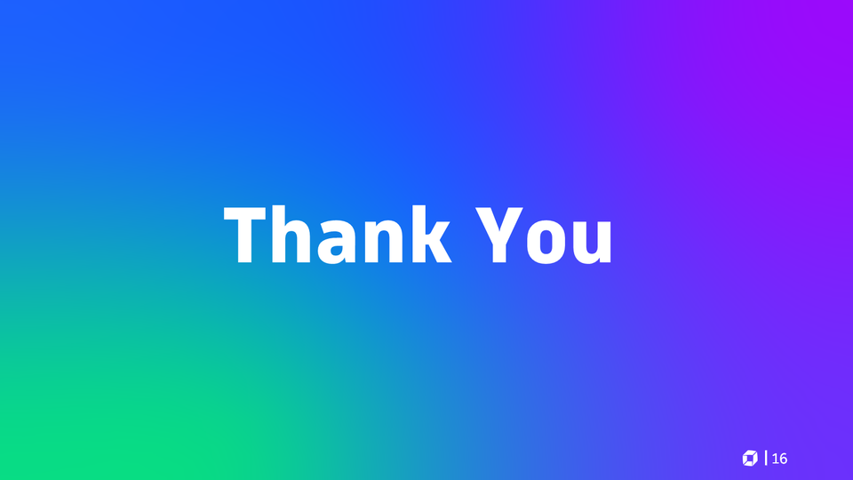

- **Cuándo usarlo:** Siempre, como última slide.
- **Consejos:** Sin placeholders. En español, cambia `Thank You` por `Gracias`: `"Thank You": "Gracias"`.

Sin claves de texto.
